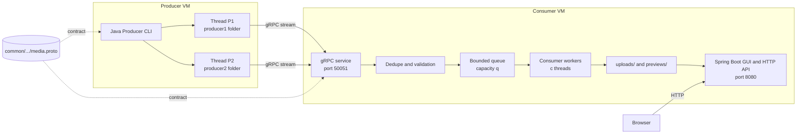

# DISCM P3 Media Upload Service

## 1. Project Overview

This project simulates a distributed media upload service. Multiple Producer threads read video files from separate folders and stream them to a Consumer over gRPC.

The repository uses Java 17 and Maven for both the Producer and Consumer components, with Spring Boot powering the Consumer's browser-based video gallery. The project is organized into three Maven modules: common, producer, and consumer.

The common module contains the shared gRPC contract and Protocol Buffers definitions used for communication between the Producer and Consumer. The Producer handles video discovery, SHA-256 hashing, and streaming uploads, while the Consumer validates incoming uploads, handles duplicate detection, manages a bounded processing queue, processes accepted videos using FFmpeg, and registers them in the video catalog.

The Consumer also provides a web-based video gallery where users can browse uploaded videos, view previews, and play video content.

The entire project is built and tested using Maven, with JUnit 5 used for automated testing.

## 2. System Architecture

The project is a multi-module Maven build: `common` (shared protocol), `producer`, `consumer`, and `tools` (stress-test and log-summary utilities).

- **Producer:** Java CLI (`producer` module) starts `p` threads. Thread `P1` reads `producer1/`, `P2` reads `producer2/`, and so on under the selected root (e.g. `sample_videos/`). Each `ProducerWorker` streams video chunks and metadata to the Consumer through gRPC (`GrpcUploadClient`).
- **Consumer:** Java gRPC service (`MediaUploadServiceImpl`) checks metadata and file contents, handles duplicate checks (`DedupeRegistry`) and queue-capacity checks, then passes accepted uploads to `c` worker threads (`ConsumerWorker`).
- **Queue:** `q` is the maximum number of slots reserved by uploads in progress plus jobs waiting in the queue (`LeakyBucket`). A full queue returns a dropped status without waiting for a slot. A worker releases the slot when it takes a job for processing.
- **Media processing:** Workers use `MediaProcessor` to validate each upload and generate a preview clip and thumbnail. Original files are saved to `consumer/uploads/` and generated assets to `consumer/previews/`. Invalid or corrupt files (see `sample_videos/bad/`) are rejected.
- **GUI:** Spring Boot serves the gallery and HTTP API on port `8080` by default. It reads the Consumer's video catalog (`VideoCatalog` / `DefaultVideoCatalog`).
- **Shared protocol:** `common/src/main/proto/media.proto` defines the upload stream, upload result statuses, and queue-status RPC. Java gRPC code for both the Producer and Consumer is generated from this file during the Maven build of the `common` module.



For the intended two-VM arrangement, run the Producer on VM A and the Java Consumer/GUI on VM B. The Producer connects to the Consumer VM's address on TCP port `50051`. A browser that needs to view the gallery connects to port `8080` on VM B. The repository contains automated local integration tests, but no evidence that deployment across two separate VMs has been tested.

## 3. Technologies Used

| Technology | Version or use in this repository |
|---|---|
| Java | Java 17, used by all modules |
| Maven | Multi-module parent with `common`, `producer`, `consumer`, and `tools` modules; Maven Wrapper is not included |
| Spring Boot | 3.2.5; Consumer HTTP GUI and REST endpoints |
| gRPC Java | 1.68.1; Consumer upload service and Producer client |
| Protocol Buffers | protoc 3.25.5 via the Maven protobuf plugin; shared contract is `common/src/main/proto/media.proto` |
| JUnit and Mockito | Unit and integration tests for the Producer and Consumer (run through Maven Surefire) |
| FFmpeg / FFprobe | Consumer video validation, preview, thumbnail, duration, and compression processing (`MediaProcessor`) |
| HTML, CSS, JavaScript | Static browser gallery in `consumer/src/main/resources/static/` |

Docker is not required or configured by the repository.

## 4. Project Structure

```text
.
├── pom.xml                          # Maven parent; includes common, producer, consumer, and tools modules
├── common/
│   ├── pom.xml                      # Generates Java protobuf and gRPC classes during the build
│   └── src/main/proto/
│       └── media.proto              # Shared gRPC service and message definitions
├── producer/
│   ├── pom.xml
│   └── src/
│       ├── main/java/com/example/producer/
│       │   ├── Main.java            # Producer CLI entry point
│       │   ├── ProducerWorker.java  # Per-folder upload thread (P1, P2, ...)
│       │   ├── GrpcUploadClient.java # gRPC client, metadata and chunk streaming
│       │   └── ProducerStats.java   # Upload counters and summary
│       └── test/java/...            # Producer JUnit tests
├── consumer/
│   ├── pom.xml                      # Consumer dependencies (gRPC, Spring Boot)
│   ├── src/
│   │   ├── main/java/com/example/media/consumer/
│   │   │   ├── ConsumerConfig.java
│   │   │   ├── server/              # gRPC service (MediaUploadServiceImpl) and ConsumerRuntime
│   │   │   ├── queue/               # LeakyBucket bounded queue, Job, QueueStatus
│   │   │   ├── worker/              # ConsumerWorker threads
│   │   │   ├── dedupe/              # DedupeRegistry for duplicate uploads
│   │   │   ├── media/               # MediaProcessor (validation, preview, thumbnail, compression)
│   │   │   ├── catalog/             # VideoCatalog, DefaultVideoCatalog, VideoItem
│   │   │   └── gui/                 # Spring Boot app, GUI and REST controllers
│   │   ├── main/resources/
│   │   │   ├── application.properties
│   │   │   └── static/              # index.html, css/style.css, js/app.js (gallery)
│   │   └── test/java/...            # Consumer JUnit tests (integration, queue, dedupe, media, GUI)
│   ├── uploads/                     # Saved original videos (runtime output)
│   └── previews/                    # Generated preview clips and thumbnails (runtime output)
├── tools/
│   ├── pom.xml
│   └── src/main/java/com/example/tools/
│       ├── stressTest.java          # Load/stress test utility
│       └── logSummary.java          # Summarizes Producer and Consumer logs
├── sample_videos/
│   ├── producer1/                   # Videos for Producer thread P1
│   ├── producer2/                   # Videos for Producer thread P2
│   ├── producer3/                   # Videos for Producer thread P3
│   └── bad/                         # Corrupt or non-video samples for rejection tests
├── docs/                            # Project documentation
└── scripts/                         # Helper scripts
```

Each Maven module also produces a `target/` directory with build output, which is not tracked in the structure above.

## 5. Prerequisites

Install the following on each computer where a component will run. The Producer and Consumer are both Java applications built with the same Maven project.

- **JDK 17 or newer** for the Producer, Consumer, and tools. [Eclipse Temurin downloads](https://adoptium.net/temurin/releases/) are one JDK option.
- **Apache Maven** for building and running all modules. [Maven installation guide](https://maven.apache.org/install.html). This repository does not include `mvnw`.
- **FFmpeg and FFprobe** available on `PATH` on the Consumer machine, for media validation, preview, thumbnail, and compression processing. Install from [FFmpeg](https://ffmpeg.org/download.html) and verify both commands work.

Check installations in PowerShell:

```powershell
java -version
mvn -version
ffmpeg -version
ffprobe -version
```

## 6. Installation and Setup

### 6.1 Get the source

Clone the project, then change into its directory:

```powershell
git clone <repository-url>
cd <repository-directory>
```

Replace the placeholders with the repository URL and directory you use. No repository URL is recorded in this README.

### 6.2 Build the project

From the repository root:

```powershell
mvn clean package
```

This builds the `common`, `producer`, `consumer`, and `tools` modules in order. The `common` module generates the Java protobuf and gRPC classes from `common/src/main/proto/media.proto`, which the Producer and Consumer both depend on. The build also compiles the Java code and runs the JUnit tests. Do not edit the generated files manually.

To build only the Consumer and the modules it depends on:

```powershell
mvn -pl consumer -am clean package
```

Maven must be installed and available as `mvn` in PowerShell. The Consumer tests may need FFmpeg and FFprobe on `PATH` (see Section 5).

### 6.3 Configure the application

The Producer and Consumer accept command-line options and environment variables. Command-line values take precedence over the corresponding environment defaults.

| Setting | Component | Default | Purpose |
|---|---|---:|---|
| `P` / `--p` | Producer | `1` | Number of producer threads |
| `PRODUCER_ROOT` / `--root` | Producer | `./sample_videos` | Root containing `producer1/`, `producer2/`, etc. |
| `CONSUMER_ADDR` / `--addr` | Producer | `localhost:50051` | Consumer gRPC host and port |
| `--on-drop` | Producer | `retry` | Retry or skip when the Consumer reports a full queue |
| `--max-drop-retries` | Producer | `3` | Maximum queue-full retries |
| `--respect-backpressure` | Producer | off | Query queue status and wait briefly while it is full |
| `C` / `--c` | Consumer | `2` | Number of Consumer worker threads |
| `Q` / `--q` | Consumer | `5` | Leaky-bucket capacity |
| `GRPC_PORT` / `--grpc-port` | Consumer | `50051` | Consumer gRPC port |
| `GUI_PORT` | Consumer GUI | `8080` | Spring Boot HTTP port |
| `UPLOAD_DIR` / `--upload-dir` | Consumer | `./uploads` | Saved video directory |
| `PREVIEW_DIR` / `--preview-dir` | Consumer | `./previews` | Preview and thumbnail directory |
| `USE_FAKE` / `--media.use-fake` | Consumer GUI | `true` | Use demo catalog instead of real uploaded-video catalog |
| `MAX_UPLOAD_SIZE_MB` / `--max-upload-size-mb` | Consumer | `500` | Maximum accepted upload size in MiB |
| `ENABLE_DEDUP` / `--enable-dedup` | Consumer | `true` | Enable SHA-256 duplicate detection |
| `ENABLE_COMPRESS` / `--enable-compress` | Consumer | `false` | Compress accepted videos after preview generation |
| `WORKER_DELAY_MS` / `--worker-delay-ms` | Consumer | `0` | Optional worker delay for demonstrations |

Consumer command-line options are passed to the Spring Boot application (for example, with `spring-boot.run.arguments`). `application.properties` supplies the GUI port, fake-catalog setting, upload/preview directories, and `C`/`Q` defaults.

## 7. Running the Application

### 7.1 Verify the build and tests

From the repository root, each of these should end in `BUILD SUCCESS`:

```powershell
mvn -pl producer -am test
mvn -pl consumer -am test
```

### 7.2 Run locally

**Consumer side**

1. Build the project and run all tests:

   ```powershell
   mvn clean test
   ```

2. Install the Consumer and its dependencies (including `common`) into the local Maven repository:

   ```powershell
   mvn -pl consumer -am install -DskipTests
   ```

3. Start the Spring Boot app with the real video catalog:

   ```powershell
   $env:USE_FAKE = "false"
   mvn -pl consumer spring-boot:run
   ```

4. Open [http://localhost:8080](http://localhost:8080) and check that the video gallery loads, previews play when hovering over a video, and videos play when clicked.

**Producer side**

1. Open a second PowerShell window at the repository root. Optionally, create a new test video by re-encoding an existing one:

   ```powershell
   ffmpeg -y -i sample_videos\producer1\short5.mp4 -c:v libx264 -preset veryfast -crf 30 -an sample_videos\producer3\new_video.mp4
   ```

2. Run the Producer with three threads (`P1` to `P3` read `producer1/` to `producer3/`):

   ```powershell
   mvn -pl producer exec:java "-Dexec.args=--p 3 --root sample_videos"
   ```

   Videos that were already uploaded are rejected as duplicates, so re-running does not change the gallery.

3. Refresh the browser gallery and check that the new videos appear, previews play on hover, and videos play.

### 7.3 Run across two VMs

This describes the configuration implied by the code; it has not been tested on two separate VMs.

1. On VM B (Consumer), install the JDK, Maven, and FFmpeg, then follow the Consumer steps in 7.2.
2. On VM B, run `ipconfig` and note the IPv4 address reachable from VM A. Allow inbound TCP `50051` (gRPC) on VM B's firewall, and `8080` for machines that should view the GUI.
3. On VM A (Producer), install the JDK and Maven, copy the project, and run `mvn -pl consumer -am install -DskipTests` once so `common` is available. Then run, replacing the placeholder with VM B's address:

   ```powershell
   mvn -pl producer exec:java "-Dexec.args=--p 3 --root sample_videos --addr <consumer-vm-ip>:50051"
   ```

4. From a browser that can reach VM B, open `http://<consumer-vm-ip>:8080`.

The gRPC connection is insecure; TLS and authentication are not configured. Use it only on a network that is appropriate for a class demonstration.

## 8. Features Implemented

- Multiple Producer threads upload concurrently, each reading only its own `producerN` folder.
- Videos are streamed in chunks; the Producer chunk size is capped at 256 KiB.
- The Consumer validates metadata, allowed video extensions (`.mp4`, `.mkv`, `.avi`, `.mov`, `.webm`), file size, bytes received, and SHA-256.
- The Consumer reserves capacity without blocking when a queue slot is unavailable. It returns `DROPPED_QUEUE_FULL`; the Producer defaults to retrying a drop up to three times, and `--on-drop skip` selects skipping instead.
- SHA-256 duplicate detection (`DedupeRegistry`) checks stored and pending uploads when enabled.
- Consumer workers write uniquely named files under `uploads/`, generate a preview up to 10 seconds long, and generate a JPEG thumbnail under `previews/` using FFmpeg/FFprobe (`MediaProcessor`).
- Corrupt or non-video files (such as those in `sample_videos/bad/`) are rejected.
- Optional Consumer compression is disabled by default (`ENABLE_COMPRESS=false`). When enabled, the worker transcodes using H.264/AAC settings.
- The Producer prints per-thread and total counts for files, accepted, dropped, duplicate, rejected, failed, retries, backpressure waits, and transferred MiB (`ProducerStats`).
- The browser GUI lists catalog videos, previews on hover, and opens full playback on click. The Java HTTP endpoints include `GET /api/videos`, `GET /api/status`, `GET /media/{id}`, `GET /preview/{id}`, and `GET /thumb/{id}`.
- Video and preview streaming use HTTP byte-range responses for browser seeking. Thumbnails use the generated image when available and otherwise have an SVG fallback.

## 9. Testing

All tests are Java (JUnit and Mockito) and run through Maven Surefire. From the repository root, each command below should end in `BUILD SUCCESS`:

```powershell
mvn -pl producer -am test
mvn -pl consumer -am test
```

To run the tests for every module at once:

```powershell
mvn clean test
```

The Consumer tests may need FFmpeg and FFprobe on `PATH` (see Section 5).

### Consumer tests

| Test class | Covers |
|---|---|
| `LeakyBucketTest` | Queue capacity and slot reservation/release |
| `DedupeRegistryTest` | SHA-256 duplicate detection |
| `MediaProcessorTest` | Validation, preview, thumbnail, and compression processing |
| `MediaUploadServiceImplTest` | Upload service decisions and cleanup |
| `ConsumerIntegrationTest` | Consumer integration behavior |
| `ConsumerVerificationTest` | Multiple simulated clients, queue, and worker behavior |
| `GuiEndpointsTest` | GUI/API endpoints, including HTTP range requests |

### Producer tests

| Test class | Covers |
|---|---|
| `GrpcUploadClientTest` | gRPC client, metadata and chunk streaming |
| `ProducerWorkerTest` | Per-folder worker behavior |
| `ProducerWorkerUploadTest` | Worker upload flow, including drop and retry handling |
| `ProducerStatsTest` | Upload counters and summary |

To run a single test class:

```powershell
mvn -pl consumer -am -Dtest=GuiEndpointsTest -Dsurefire.failIfNoSpecifiedTests=false test
```

The integration and verification tests exercise multiple simulated clients locally; they do not establish that a separate-VM network deployment works.

### Manual local integration check

Start the Consumer in real-catalog mode and run the Producer as described in Section 7.2. Check the Consumer logs, `consumer/uploads/`, `consumer/previews/`, the GUI, and the Producer's final summary. This is a manual procedure; no successful run is claimed here.

## 10. Sample Producer Output

The following illustrates the format produced by `producer.main`; values are examples, not captured test output:

```text
2026-11-22 12:00:00,000 | P1 | starting: 1 video(s) in sample_videos\producer1
2026-11-22 12:00:00,120 | P1 | ACCEPTED sample15.mp4 (93054 bytes, 0.12s)
2026-11-22 12:00:00,150 | P2 | DUPLICATE sample15.mp4: Duplicate upload.

   thread     files  accepted   dropped duplicate  rejected    failed   retries     waits        MB
       P1         1         1         0         0         0         0         0         0       0.1
       P2         1         0         0         1         0         0         0         0       0.0
    TOTAL         2         1         0         1         0         0         0         0       0.1
elapsed: 0.2s
```

Outcome meanings:

- **Accepted:** Consumer accepted the upload into its processing queue.
- **Dropped:** Queue was full and Producer stopped retrying (or drop handling was set to skip).
- **Duplicate:** Matching SHA-256 was already stored or pending, when deduplication is enabled.
- **Rejected:** Consumer rejected invalid metadata or file data.
- **Failed:** Upload ended with a transport error after retries, an unknown status, a file-read error, or interruption.
- **Retries / waits:** Retries after a queue drop or transient network error, and time spent polling queue status when `--respect-backpressure` is enabled.

The printed MB value is bytes successfully accepted by the Producer divided by 1,048,576. A queue-full retry log is an intermediate event; it increments retries and only increments dropped if the Producer eventually gives up.

## 11. Troubleshooting

| Problem | What to check |
|---|---|
| `mvn` is not recognized | Install Apache Maven, reopen PowerShell, and verify `mvn -version`. No Maven Wrapper is included. |
| Java version mismatch | Run `java -version` and confirm the active JDK is 17 or newer. `JAVA_HOME` and `PATH` should point to the same JDK. |
| `ffmpeg` or `ffprobe` not recognized | Install FFmpeg, add its `bin` folder to `PATH`, open a new terminal, then run both `ffmpeg -version` and `ffprobe -version`. |
| Producer cannot connect | Confirm the Consumer is running, `--addr` points to its reachable host, the port matches `GRPC_PORT`/`--grpc-port`, and TCP `50051` is allowed through VM firewalls. |
| Wrong VM address | On the Consumer VM, use `ipconfig` and choose the IPv4 address reachable from the Producer VM. `localhost` only refers to the same machine. |
| Port already in use | Check whether another process is using port `50051` or `8080`; stop that process or choose another Consumer gRPC port / GUI `GUI_PORT` and configure the Producer to match gRPC. |
| GUI does not load | Confirm the Consumer started without a Spring error, check `GUI_PORT` (default `8080`), and open the matching local or VM URL. |
| GUI shows demo entries instead of uploads | Set `USE_FAKE=false` before starting the Consumer. The default is `true`. |
| Upload succeeds but video is rejected during processing | Confirm the file is a real supported video and FFmpeg/FFprobe run from the Consumer process environment. Check Consumer logs for the processing error. |
| `mvn ... clean package` fails during tests | Read the first failing test and stack trace. Some video-processing test coverage requires FFmpeg/FFprobe. Do not treat skipping tests as a fix. |

## 12. Stopping and Restarting

- Stop the Producer with **Ctrl+C** in its terminal. It signals its producer threads to stop and waits for them to exit.
- Stop the Consumer with **Ctrl+C** in its terminal. The Java runtime shuts down its gRPC server and worker executors.
- Restart each component with the same commands and configuration.
- Final videos in `uploads/` and generated files in `previews/` are stored on disk and persist across process restarts unless manually deleted. The Consumer scans saved uploads and rebuilds its dedupe registry when real-catalog mode starts.
- The queue and its counters are in memory, so queued work and runtime counters do not persist through a Consumer restart. Only videos already saved to disk persist.

## 13. Limitations and Future Improvements

- Two-VM networking, firewall rules, and cross-machine file/system configuration have not been verified in this repository.
- The gRPC connection is insecure and has no authentication or TLS configuration.
- Browser playback depends on the browser's supported codecs. The Java Consumer creates H.264 previews; original full videos retain their uploaded encoding unless compression is enabled.
- The project does not include containers, deployment manifests, or automated VM provisioning.