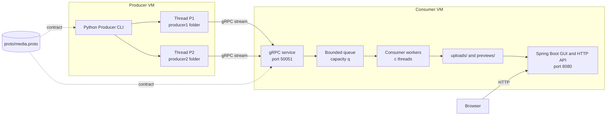

# DISCM P3 Media Upload Service

## 1. Project Overview

This project simulates a media upload service. Producer threads read video files from separate folders and stream them to a Consumer over gRPC. The Consumer validates uploads, reserves space in a bounded queue, processes accepted videos, and presents a browser-based gallery.

The repository currently uses a **Python Producer** and a **Java 17 / Spring Boot Consumer**. Both sides use the same gRPC contract in `proto/media.proto`. The Python Producer and its local helper tools are part of this checkout; the Maven build covers the Java Consumer only.

## 2. System Architecture

- **Producer:** Python CLI starts `p` threads. Thread `P1` reads `producer1/`, `P2` reads `producer2/`, and so on under the selected root. Each thread streams video chunks and metadata through gRPC.
- **Consumer:** Java gRPC service checks metadata and file contents, handles duplicate and queue-capacity checks, then passes accepted uploads to `c` worker threads.
- **Queue:** `q` is the maximum number of slots reserved by uploads in progress plus jobs waiting in the queue. A full queue returns a dropped status without waiting for a slot. A worker releases the slot when it takes a job for processing.
- **GUI:** Spring Boot serves the gallery and HTTP API on port `8080` by default. It reads the Consumer's video catalog.
- **Shared protocol:** `proto/media.proto` defines the upload stream, upload result statuses, and queue-status RPC. Java gRPC code is generated from this file during the Maven build. Python gRPC classes are checked in under `common/`.



For the intended two-VM arrangement, run the Producer on VM A and the Java Consumer/GUI on VM B. The Producer connects to the Consumer VM's address on TCP port `50051`. A browser that needs to view the gallery connects to port `8080` on VM B. The repository contains automated local integration tests, but no evidence that deployment across two separate VMs has been tested.

## 3. Technologies Used

| Technology | Version or use in this repository |
|---|---|
| Java | Java 17, configured by the Maven Consumer project |
| Maven | Multi-module parent with a `consumer` module; Maven Wrapper is not included |
| Spring Boot | 3.2.5; HTTP GUI and REST endpoints |
| gRPC Java | 1.63.0; Consumer upload service |
| Protocol Buffers | Java Maven plugin uses protoc 3.25.3; shared contract is `proto/media.proto` |
| Python | Python Producer, generated gRPC client code, and helper/test tools |
| gRPC Python | Checked-in generated stubs require `grpcio` 1.85.1 or later |
| Protocol Buffers Python | Checked-in generated message module requires `protobuf` 7.35.1 or later |
| pytest | Python test suite |
| FFmpeg / FFprobe | Consumer video preview, thumbnail, duration, and optional compression processing; Python media helper tests also use them |
| HTML, CSS, JavaScript | Static browser gallery in `consumer/src/main/resources/static/` |

Docker is not required or configured by the repository.

## 4. Project Structure

```text
.
├── pom.xml                         # Maven parent; includes the Consumer module
├── proto/
│   └── media.proto                 # Shared gRPC service and message definitions
├── consumer/
│   ├── pom.xml                     # Java Consumer dependencies and proto generation
│   └── src/
│       ├── main/java/...           # Consumer config, gRPC server, workers, queue, GUI/API
│       ├── main/resources/
│       │   ├── application.properties
│       │   └── static/              # HTML, CSS, JavaScript gallery
│       └── test/java/...           # Java Consumer JUnit tests
├── producer/
│   ├── main.py                     # Python Producer entry point
│   ├── client.py                   # gRPC client, metadata and chunk streaming
│   ├── worker.py                   # Per-folder upload threads and retry behavior
│   └── stats.py                    # Thread-safe counters and summary table
├── common/
│   ├── media_pb2.py                # Generated Python protocol messages
│   └── media_pb2_grpc.py           # Generated Python gRPC stubs
├── consumer/
│   ├── dedupe.py                   # Python SHA-256/dedup helper used by Producer
│   └── media.py                    # Python FFmpeg media helpers and their tests
├── sample_videos/
│   ├── producer1/                  # Videos for Producer thread P1
│   ├── producer2/                  # Videos for Producer thread P2
│   └── bad/                        # Corrupt/non-video samples; not read by default run
├── tools/
│   ├── fake_consumer.py            # Fake gRPC endpoint for Producer development/tests
│   ├── smoke_upload.py              # Upload one file to a running Consumer
│   └── summarize_logs.py           # Reconcile Producer/Consumer logs
└── tests/                          # Python tests for Producer, helpers, and log summary
```

The `consumer/` directory has both Java Consumer source under `consumer/src/` and Python support files at its top level. Some top-level Python modules (`server.py`, `workers.py`, and `catalog.py`) are empty placeholders; the running Consumer server and GUI are the Java application.

## 5. Prerequisites

Install the following on the computer where each component will run:

- **JDK 17 or newer** for the Java Consumer. [Eclipse Temurin downloads](https://adoptium.net/temurin/releases/) are one JDK option.
- **Apache Maven** for building and starting the Consumer. [Maven installation guide](https://maven.apache.org/install.html). This repository does not include `mvnw`.
- **Python 3** for the Producer and Python tests. Use a Python version compatible with the installed `grpcio` and `protobuf` releases.
- **Python packages:** `grpcio >= 1.85.1`, `protobuf >= 7.35.1`, and `pytest` for tests. There is no `requirements.txt` or `pyproject.toml` in this repository.
- **FFmpeg and FFprobe** available on `PATH` for Consumer media processing and Python media tests. Install from [FFmpeg](https://ffmpeg.org/download.html) and verify both commands work.

Check installations in PowerShell:

```powershell
java -version
mvn -version
python --version
ffmpeg -version
ffprobe -version
```

## 6. Installation and Setup

### 6.1 Get the source

Clone the project, then change into its directory:

```powershell
git clone <repository-url>
cd <repository-directory>
```

Replace the placeholders with the repository URL and directory you use. No repository URL is recorded in this README.

### 6.2 Build the Java Consumer

From the repository root:

```powershell
mvn -pl consumer clean package
```

The Consumer Maven build compiles Java, generates Java gRPC classes from `proto/media.proto`, and runs the Java tests. Maven must be installed and available as `mvn` in PowerShell.

### 6.3 Set up the Python Producer environment

From the repository root, create and activate a virtual environment, then install the packages required by the checked-in generated stubs and tests:

```powershell
python -m venv .venv
.\.venv\Scripts\Activate.ps1
python -m pip install --upgrade pip
python -m pip install "grpcio>=1.85.1" "protobuf>=7.35.1" pytest
```

If PowerShell blocks activation, use the environment's Python directly instead:

```powershell
.\.venv\Scripts\python.exe -m pip install "grpcio>=1.85.1" "protobuf>=7.35.1" pytest
.\.venv\Scripts\python.exe -m producer.main --help
```

The checked-in Python gRPC modules mean code generation is not needed to run the Python Producer. The Java Consumer Maven plugin generates its gRPC code as part of the build; do not edit generated files manually.

### 6.4 Configure the application

The Producer accepts command-line options and environment variables. Command-line values take precedence over the corresponding Producer environment defaults.

| Setting | Component | Default | Purpose |
|---|---|---:|---|
| `P` / `--p` | Producer | `1` | Number of producer threads |
| `PRODUCER_ROOT` / `--root` | Producer | `./sample_videos` | Root containing `producer1/`, `producer2/`, etc. |
| `CONSUMER_ADDR` / `--addr` | Producer | `localhost:50051` | Consumer gRPC host and port |
| `--on-drop` | Producer | `retry` | Retry or skip when the Consumer reports a full queue |
| `--max-drop-retries` | Producer | `3` | Maximum queue-full retries |
| `--respect-backpressure` | Producer | off | Query queue status and wait briefly while it is full |
| `C` / `--c` | Consumer | `2` | Number of Consumer worker threads |
| `Q` / `--q` | Consumer | `5` | Leaky-bucket capacity |
| `GRPC_PORT` / `--grpc-port` | Consumer | `50051` | Consumer gRPC port |
| `GUI_PORT` | Consumer GUI | `8080` | Spring Boot HTTP port |
| `UPLOAD_DIR` / `--upload-dir` | Consumer | `./uploads` | Saved video directory |
| `PREVIEW_DIR` / `--preview-dir` | Consumer | `./previews` | Preview and thumbnail directory |
| `USE_FAKE` / `--media.use-fake` | Consumer GUI | `true` | Use demo catalog instead of real uploaded-video catalog |
| `MAX_UPLOAD_SIZE_MB` / `--max-upload-size-mb` | Consumer | `500` | Maximum accepted upload size in MiB |
| `ENABLE_DEDUP` / `--enable-dedup` | Consumer | `true` | Enable SHA-256 duplicate detection |
| `ENABLE_COMPRESS` / `--enable-compress` | Consumer | `false` | Compress accepted videos after preview generation |
| `WORKER_DELAY_MS` / `--worker-delay-ms` | Consumer | `0` | Optional worker delay for demonstrations |

Consumer command-line options are passed to the Spring Boot application (for example, with `spring-boot.run.arguments`). Environment variable names are listed above. `application.properties` supplies the GUI port, fake-catalog setting, upload/preview directories, and `C`/`Q` defaults.

## 7. Running the Application

### 7.1 Run locally

1. Open a PowerShell window at the repository root.
2. Start the Java Consumer with real catalog mode. The first command-line argument string passes options to the Spring Boot application:

   ```powershell
   $env:USE_FAKE = "false"
   mvn -pl consumer spring-boot:run "-Dspring-boot.run.arguments=--c=2 --q=5 --grpc-port=50051"
   ```

   To use other Consumer CLI settings, add them to that argument string. The Consumer will create its default `uploads/` and `previews/` directories relative to its working directory.

3. Open the GUI at [http://localhost:8080](http://localhost:8080). The gallery polls the Consumer API and displays videos registered in the real catalog.
4. Open a second PowerShell window at the repository root, activate the Python virtual environment if needed, and start two producer threads:

   ```powershell
   .\.venv\Scripts\Activate.ps1
   python -m producer.main --p 2 --root sample_videos --addr localhost:50051
   ```

   `P1` reads `sample_videos\producer1`; `P2` reads `sample_videos\producer2`. The current sample folders include valid videos and a same-content video in both producer folders, so the second copy can receive a duplicate result when deduplication is enabled.

A GUI started with the default `USE_FAKE=true` uses sample/demo catalog data and does not display real uploads. Set `USE_FAKE=false` for the real catalog mode shown above.

### 7.2 Run across two VMs

This describes the network configuration implied by the code; it has not been verified on two separate VMs.

1. Install Java/Maven/FFmpeg on VM B (Consumer) and Python plus the required packages on VM A (Producer).
2. On VM B, start the Consumer with the real catalog enabled and with the default gRPC port open:

   ```powershell
   $env:USE_FAKE = "false"
   mvn -pl consumer spring-boot:run "-Dspring-boot.run.arguments=--c=2 --q=5 --grpc-port=50051"
   ```

3. On VM B, run `ipconfig` and find the IPv4 address on the network adapter reachable from VM A. Avoid `localhost` for a remote Producer.
4. Allow inbound TCP `50051` on VM B's firewall and any intervening VM/network firewall. Port `8080` is needed only from machines that should view the GUI. The Producer needs outbound access from VM A to VM B on `50051`.
5. On VM A, place videos in separate folders under a root directory, then run (replace the placeholder with VM B's reachable IPv4 address):

   ```powershell
   python -m producer.main --p 2 --root sample_videos --addr <consumer-vm-ip>:50051
   ```

6. From a browser that can reach VM B, open `http://<consumer-vm-ip>:8080`.

The gRPC server uses an insecure channel/server configuration; TLS and authentication are not configured by this project. Use only a network where that is appropriate for your class demonstration.

### 7.3 Run one video upload manually

With the Java Consumer running, the Python helper can upload one video and print the response:

```powershell
python -m tools.smoke_upload sample_videos/producer1/sample15.mp4 --addr localhost:50051 --id P1
```

## 8. Features Implemented

- Multiple Producer threads upload concurrently, each reading only its own `producerN` folder.
- Videos are streamed in chunks; the Producer chunk size is capped at 256 KiB.
- The Consumer validates metadata, allowed video extensions (`.mp4`, `.mkv`, `.avi`, `.mov`, `.webm`), file size, bytes received, and SHA-256.
- The Consumer reserves capacity without blocking when a queue slot is unavailable. It returns `DROPPED_QUEUE_FULL`; the Producer defaults to retrying a drop up to three times, and `--on-drop skip` selects skipping instead.
- SHA-256 duplicate detection checks stored and pending uploads when enabled.
- Consumer workers write uniquely named files under `uploads/`, generate a preview up to 10 seconds long, and generate a JPEG thumbnail under `previews/` using FFmpeg/FFprobe.
- Optional Consumer compression is disabled by default (`ENABLE_COMPRESS=false`). When enabled, the Java worker transcodes using H.264/AAC settings.
- The Producer prints per-thread and total counts for files, accepted, dropped, duplicate, rejected, failed, retries, backpressure waits, and transferred MiB.
- The browser GUI lists catalog videos, previews on hover, and opens full playback on click. The Java HTTP endpoints include `GET /api/videos`, `GET /api/status`, `GET /media/{id}`, `GET /preview/{id}`, and `GET /thumb/{id}`.
- Video and preview streaming use HTTP byte-range responses for browser seeking. Thumbnails use the generated image when available and otherwise have an SVG fallback.

## 9. Testing

### Java Consumer tests

From the repository root:

```powershell
mvn -pl consumer clean package
```

This compiles the Consumer, generates Java gRPC classes, and runs the Java test suite. Tests cover queue capacity behavior, upload service decisions and cleanup, Consumer integration behavior, configuration and gRPC startup, and GUI endpoints including HTTP range requests. The integration/verification tests exercise multiple simulated clients locally; they do not establish that a separate-VM network deployment works.

To run a single Java test class:

```powershell
mvn -pl consumer -Dtest=GuiEndpointsTest test
```

Other Java test class names include `LeakyBucketTest`, `MediaUploadServiceImplTest`, `ConsumerIntegrationTest`, and `ConsumerVerificationTest`.

### Python tests

Install the Python packages in section 6 first, then from the repository root run:

```powershell
python -m pytest -v
```

The suite includes:

- `tests/test_producer.py`: Producer concurrency, chunking, retry/drop handling, duplicates, backpressure, and logging counters against `tools/fake_consumer.py`.
- `tests/test_dedupe.py`: Python SHA-256 registry behavior and concurrent reservations.
- `tests/test_media.py`: Python FFmpeg helper behavior for duration, previews, thumbnails, compression, and parallel helper calls.
- `tests/test_summarize_logs.py`: log parsing and Producer/Consumer outcome reconciliation.

These Python tests do not run the Java Consumer as a live gRPC server. `tools/fake_consumer.py` is a test/development endpoint; it does not save videos or run the real Consumer queue.

### Manual local integration check

Start the Java Consumer in real-catalog mode as in section 7.1, then run the Python Producer against `localhost:50051`. Check the Consumer logs, `uploads/`, `previews/`, the GUI, and the Producer's final summary. This is a manual procedure; no successful run is claimed here.

## 10. Sample Producer Output

The following illustrates the format produced by `producer.main`; values are examples, not captured test output:

```text
2026-11-22 12:00:00,000 | P1 | starting: 1 video(s) in sample_videos\producer1
2026-11-22 12:00:00,120 | P1 | ACCEPTED sample15.mp4 (93054 bytes, 0.12s)
2026-11-22 12:00:00,150 | P2 | DUPLICATE sample15.mp4: Duplicate upload.

   thread     files  accepted   dropped duplicate  rejected    failed   retries     waits        MB
       P1         1         1         0         0         0         0         0         0       0.1
       P2         1         0         0         1         0         0         0         0       0.0
    TOTAL         2         1         0         1         0         0         0         0       0.1
elapsed: 0.2s
```

Outcome meanings:

- **Accepted:** Consumer accepted the upload into its processing queue.
- **Dropped:** Queue was full and Producer stopped retrying (or drop handling was set to skip).
- **Duplicate:** Matching SHA-256 was already stored or pending, when deduplication is enabled.
- **Rejected:** Consumer rejected invalid metadata or file data.
- **Failed:** Upload ended with a transport error after retries, an unknown status, a file-read error, or interruption.
- **Retries / waits:** Retries after a queue drop or transient network error, and time spent polling queue status when `--respect-backpressure` is enabled.

The printed MB value is bytes successfully accepted by the Producer divided by 1,048,576. A queue-full retry log is an intermediate event; it increments retries and only increments dropped if the Producer eventually gives up.

## 11. Troubleshooting

| Problem | What to check |
|---|---|
| `mvn` is not recognized | Install Apache Maven, reopen PowerShell, and verify `mvn -version`. No Maven Wrapper is included. |
| Java version mismatch | Run `java -version` and confirm the active JDK is 17 or newer. `JAVA_HOME` and `PATH` should point to the same JDK. |
| PowerShell blocks virtual-environment activation | Use `.\.venv\Scripts\python.exe` directly for pip and Producer commands, or adjust the current-user execution policy according to your organization's rules. |
| Missing Python package | Activate `.venv` and install `grpcio>=1.85.1`, `protobuf>=7.35.1`, and (for tests) `pytest`. The repository has no dependency lock/manifest. |
| Python gRPC version error | The checked-in generated stub requires `grpcio` 1.85.1 or later; the message module requires `protobuf` 7.35.1 or later. |
| `ffmpeg` or `ffprobe` not recognized | Install FFmpeg, add its `bin` folder to `PATH`, open a new terminal, then run both `ffmpeg -version` and `ffprobe -version`. |
| Producer cannot connect | Confirm the Consumer is running, `--addr` points to its reachable host, the port matches `GRPC_PORT`/`--grpc-port`, and TCP `50051` is allowed through VM firewalls. |
| Wrong VM address | On the Consumer VM, use `ipconfig` and choose the IPv4 address reachable from the Producer VM. `localhost` only refers to the same machine. |
| Port already in use | Check whether another process is using port `50051` or `8080`; stop that process or choose another Consumer gRPC port / GUI `GUI_PORT` and configure the Producer to match gRPC. |
| GUI does not load | Confirm the Consumer started without a Spring error, check `GUI_PORT` (default `8080`), and open the matching local or VM URL. |
| GUI shows demo entries instead of uploads | Set `USE_FAKE=false` before starting the Consumer. The default is `true`. |
| Upload succeeds but video is rejected during processing | Confirm the file is a real supported video and FFmpeg/FFprobe run from the Consumer process environment. Check Consumer logs for the processing error. |
| `mvn ... clean package` fails during tests | Read the first failing test and stack trace. Some video-processing test coverage requires FFmpeg/FFprobe. Do not treat skipping tests as a fix. |

## 12. Stopping and Restarting

- Stop the Producer with **Ctrl+C** in its terminal. It signals its producer threads to stop and waits for them to exit.
- Stop the Consumer with **Ctrl+C** in its terminal. The Java runtime shuts down its gRPC server and worker executors.
- Restart each component with the same commands and configuration.
- Final videos in `uploads/` and generated files in `previews/` are stored on disk and persist across process restarts unless manually deleted. The Consumer scans saved uploads and rebuilds its dedupe registry when real-catalog mode starts.
- The queue and its counters are in memory, so queued work and runtime counters do not persist through a Consumer restart. Only videos already saved to disk persist.

## 13. Limitations and Future Improvements

- The current repository is mixed-language: the Producer and helper tools are Python, while the Consumer and GUI are Java. The attached Java Edition specification may require a Java Producer; this checkout has not yet converted it.
- No `requirements.txt` / `pyproject.toml` or Maven Wrapper is checked in, so Python dependencies and Maven installation are external setup steps.
- The top-level Python `consumer/server.py`, `consumer/workers.py`, and `consumer/catalog.py` are empty; they are not a Python Consumer implementation.
- The fake Python Consumer is for Producer development and testing only. It does not store or process media and is not a substitute for the Java Consumer.
- Two-VM networking, firewall rules, and cross-machine file/system configuration have not been verified in this repository.
- The gRPC connection is insecure and has no authentication or TLS configuration.
- Browser playback depends on the browser's supported codecs. The Java Consumer creates H.264 previews; original full videos retain their uploaded encoding unless compression is enabled.
- The project does not include containers, deployment manifests, or automated VM provisioning.